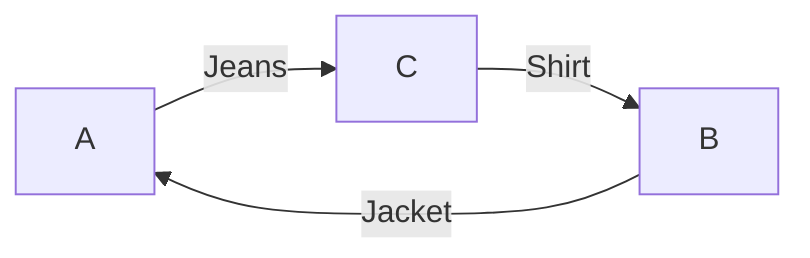

# Vintage × Meta AI — Ideas for a Solo Seven-Day Hackathon

Written: 2026-10-27
Contributors: Claude Opus 5.5 Medium · DeepSeek V4.1 Flash Max · Gemini 4 Argon High · Codex

## 1. Final Recommendation: Vintage Relay

> **A web app for in-person gatherings where AI narrows vintage clothing candidates by preference and connects three-person cycles when direct swaps are impossible.**

All four evaluators recommended it as **a solo seven-day entry candidate worth testing on day one**. Each also ranked Vintage Relay first individually. This does not mean the app is validated or the user has selected it for implementation.

Move beyond cutting/sewing/photo measurement issues in the previous discarded-denim manufacturing idea and focus on **connecting unworn clothing to new owners**. The goal goes beyond photo descriptions or styling recommendations: produce exchange schedules that actual participants have consented to.

The earlier rejection report is preserved in the [previous evaluation](result6-previous-evaluation.md). This document reports **newly requested idea exploration**; no app code has been written.

## 2. A Simple Example

Imagine three people at an existing vintage exchange gathering.

| Participant | Offers | Wants |
|---|---|---|
| A | Washed jeans | B's cropped jacket |
| B | Cropped jacket | C's striped shirt |
| C | Striped shirt | A's washed jeans |

No pair can swap directly. A cycle gives everyone one desired garment:

AI helps identify preferences from photos and natural language:

> “I dislike heavy stains but like natural fading. I'm looking for a workwear-style jacket without a large logo.”

The model does not determine authenticity, price, or exact fit. **It suggests candidates and checks; people decide what they want and whether to exchange.**

These are fictional preferences for illustration. The frequency of real three-person exchanges has not been researched.

## 3. Users and Problem

Target **organizers and participants in existing small vintage clubs/exchange gatherings**, rather than a nationwide secondhand platform.

Individual vintage garments differ in fading, logos, repairs, and condition even within the same model. Tags such as “jacket M” do not establish suitability. Direct swaps also fail when a desired garment's owner does not want mine.

The app addresses two problems:

1. Connect unstructured preferences with photos to **reduce the effort of finding candidates worth inspecting**.
2. Use participant-approved preferences to **calculate two-/three-person exchanges and manage consent, withdrawal, and duplicate item commitments**.

These remain user-problem hypotheses. In small gatherings, inspecting garments and checking choices manually may suffice. Reuse may benefit, but no waste/carbon reductions have been demonstrated.

## 4. User Flow and Seven-Day MVP

Limit to **one event room, 3–6 participants, and 6–12 total garments**. These are scope-planning values, not performance measurements.

| Stage | User action | App action |
|---|---|---|
| Register | Enter photos/descriptions, desired styles/exclusions | Structure clothing information and conditions |
| Review candidates | Inspect AI candidates and explicitly select desired garments | Show reasons, uncertainty, and checks |
| Cycle proposal | Review offered/received combinations | Calculate two-/three-person cycles from approved preferences |
| Consent | Each consents to or rejects the whole proposal | Check unanimous same-version consent and item conflicts |
| Change | Edit/withdraw items or conditions | Invalidate affected consent and search again |
| Finish | Inspect physical garments on site | Generate a handover schedule for agreed exchanges |

**Distinguish willingness to receive from final consent to a specific proposal.** A confirmed handover schedule is also distinct from completed physical handover. If rejection leaves no alternatives, report no match honestly.

No rulers/markers in photos or garment disassembly are needed. Do not present unverified fit, hidden defects, or authenticity as facts.

### Implementation Scope

- Mobile web + Python FastAPI + SQLite.
- Event roles/access, photo/condition entry, AI candidates, cycle proposals, consent/withdrawal, handover schedule.
- Exhaustively check two-/three-person cycles at this scale. Do not claim invention of a new optimization algorithm.
- Prevent duplicate item/participant commitments, stale-proposal consent, and concurrent confirmation conflicts through code and DB transactions/version checks.
- Exclude payments, shipping, external platform integrations, nationwide recruitment, live chat, price/authenticity appraisal, virtual fitting, and native apps.
- No extra models, generated lookbooks, AR, 3D, or separate model training.

## 5. Where Meta AI Is Needed

**The only required model is `muse-spark-1.3`.** Contribution to actual work matters more than model count.

Spark supports image understanding, structured output, and tool calling. These capabilities enable implementation; they do not prove preference interpretation quality. [Meta model documentation](https://dev.meta.ai/docs/models)

| Spark | Regular code and people |
|---|---|
| Connect photos/descriptions to natural-language preferences | Select garments actually wanted |
| Structure exclusions and ambiguous expressions | Store explicit conditions and confirmed preferences |
| Explain candidates and unverified points | Calculate cycles and check item resources |
| Query current state and reconsider candidates after changes | Handle consent permissions, versions, confirmation, withdrawal |

Example tools query event state, calculate cycles from approved preferences, and create unconfirmed proposals. The model uses tool results for its next suggestion and **never supplies human consent**. App code executes developer tools. [Meta tool calling](https://dev.meta.ai/docs/tool-calling)

Also provide manual preference selection. Producing the same correct proposal is expected. Evaluate AI contribution by:

- Whether it reduces missed/misinterpreted preferences and exclusions.
- Whether it reduces review/correction effort before finding suitable candidates.
- Whether reasons make candidates easier to understand and select.

**Do not credit cycle calculation results to AI.** If model candidates are wrong or increase burden, reduce claims about Meta's core contribution.

## 6. Creativity, Engineering, Time, and Competition Fit

| Perspective | Reason to recommend | Strongest remaining objection |
|---|---|---|
| Creativity | Connect vintage preferences to individual-item cycles and unanimous consent | Exchange/cycle algorithms themselves are not new |
| Impact | Find new owners without cutting or producing clothing | Demand and success rates at real gatherings unvalidated |
| Meta usage | Connect unstructured photos/language to real candidate choices | Manual checks may suffice in small gatherings |
| Engineering | Bound scope to a small graph and clear transitions | Concurrency, withdrawal, and authorization must be correct |
| Solo seven-day | No external DB, sewing, specialized equipment, shipping/payment infrastructure | API access and end-to-end implementation unverified |
| Demo | Direct-swap failure → three-person cycle → withdrawal is intuitive | Fictional-role demos do not establish real demand |

### Prior Services and Differentiation

[Lucky Sweater](https://luckysweater.com/how-it-works) already offers clothing exchanges and mutual-like matching. [LinkMySwap](https://linkmyswap.co.uk/chain-swaps) explains cycles of three or more in another domain. **Do not claim “the world's first exchange AI” or “the first three-person cycle.”**

The differentiation hypothesis is a compact complete workflow: **unstructured preferences at an in-person vintage gathering → photo candidate review → item cycles → unanimous consent/withdrawal**. Its usefulness must also be tested.

### Hackathon Rules

Recommend the **Indie Developer** track and **Build for Your World** theme. Following user-provided criteria, assess Impact, Meta usage, technical execution, and Demo at 25% each.

The eligibility argument centers on **completing multi-party exchange work and managing state**, beyond photo descriptions/search answers. State machines/tool calls do not automatically confer eligibility. Organizers ultimately decide whether it counts as a simple image analyzer.

Follow public-repository requirements, distinguish new work during the competition, provide a three-minute video, and respect data rights. Use self-shot or authorized materials; never assume others' photo/audio/video rights are automatically resolved.

## 7. Day-One Validation and Seven-Day Plan

**The recommendation is to begin with day-one validation. None of these experiments has been performed.**

| Day | Goal and checks |
|---|---|
| D1 | Record photo/condition preparation time. Verify real Spark image/structured/tool round trips. Compare missed conditions and candidate review/correction burden with a manual form. Technical smoke tests for cycles, no matches, and withdrawal. |
| D2 | Connect event/role/clothing registration to AI candidate review. |
| D3 | Complete approved-preference two-/three-person cycles end to end through screens. |
| D4 | Consent, withdrawal, item conflicts, stale-version rejection, handover schedule. |
| D5 | Test understanding, acceptance, and review burden with consenting testers' actual preferences. Disclose if unavailable. |
| D6–7 | Stabilization, failure cases, three-minute video, README/public repository/new contribution records. |

Define metrics/pass criteria **before testing**, without adjusting them after failure to fit success. Separate fictional conditions from real preference evaluation. Finding cycles for developer-made conditions validates algorithms, not actual demand/model performance.

Reconsider the entry recommendation if:

- API access fails or important preferences/exclusions remain repeatedly missed after corrections.
- Duplicate commitments or consent-version errors remain unresolved.
- End-to-end flow does not work by D3.
- By D5 there is no evidence AI materially improves interpretation or candidate review burden.

If it fails, do not automatically build two other apps in the same week. Return to idea selection.

## 8. Three-Minute Demo

1. **0:00–0:25:** identify self-shot clothing and fictional participant roles; explain why direct swapping fails.
2. **0:25–1:00:** enter natural-language preferences; inspect Spark candidates/reasons/checks; participant selects willingness to receive.
3. **1:00–1:35:** show the three-person cycle and each person's offered/received garment.
4. **1:35–2:15:** demonstrate withdrawal invalidating previous consent. Honestly report no match if no alternative exists.
5. **2:15–3:00:** unanimous consent to a valid proposal and handover schedule; briefly explain model role, code checks, and unvalidated aspects.

Do not deliberately make the algorithm fail or present fictional-role demos as actual exchanges/waste reduction.

## 9. Alternatives Considered and Exclusions

Reviewed **nine independent proposals plus two Codex proposals**. Grouped similar ideas for comparison.

| Candidate | Description | Final position |
|---|---|---|
| **Vintage Relay** | Preference candidates, two-/three-person cycles, unanimous consent, withdrawal | Main recommendation |
| **Reduced DropCut** | HTML condition cards linking inspection-video speech to garment parts/source segments | Alternative; lighter improvement of prior [Patina Inspector](idea.md) |
| **Condition Handover / PatinaDiff** | Compare existing marks with possible post-receipt changes | Deferred: nonrigid alignment/lighting false positives pose seven-day research risk |
| Clothing oral history | Link spoken memories to garment parts | Emotional appeal; differentiation/usefulness unvalidated |
| Capsule Curator / Vintage Window | Group garments into themes and generate posters/drop kits | Risk of remaining analysis/marketing content generation |
| Repair Triage | Generate repair briefs after additional observations | Risk of photo analysis/recommendations without workshop validation |
| Era clue contradiction detection | Compare period clues from labels/hardware | Reference/sample/accuracy burden; adjacent to identification/appraisal analyzers |
| RackIndex | Extract item inventory from rack video | Occlusion causes tracking ID switches; risk of becoming a simple tagger |
| ClaimDesk | Turn ambiguous sales-chat requests into reservation queues | Practicality/differentiation of a mock console without integrations unvalidated |

DropCut's core is video → transcription → part candidates → human correction → source-linked cards. Prior examples include [Artifcts](https://artifcts.com/articles/post/use-your-voice-artifcts-now-offers-in-app-audio--video-recording) voice records and [ThingLink](https://support.thinglink.com/hc/en-us/articles/360021500733-How-to-create-an-interactive-image) hotspots. It belongs to the earlier Inspector family; do not portray it as entirely new.

If selected, code checks **only missing user-confirmed statement IDs/card links**. It cannot guarantee speech omitted by STT, unmentioned defects, or truthfulness. Muse Voice provides **utterance-turn timestamps**, not word timestamps or emotion inference. [Meta speech-to-text](https://dev.meta.ai/docs/speech-to-text)

Initial claims that SAM ignores wrinkles or guarantees persistent IDs through occlusion were withdrawn. PatinaDiff's initial high scores were not used as the final recommendation basis.

## 10. Discussion Results and Supporting Documents

The three advisors initially preferred oral history, capsule curation, and before/after Diff respectively. Cross-discussion converged on reduced DropCut, then reconsidered overlap with prior planning, confusing model count with depth, and overstated vision/transcription performance.

A fresh vote on the same final document produced:

| Evaluator | Joint recommendation | Personal first choice | Required further changes |
|---|---|---|---|
| Claude Opus 5.5 Medium | APPROVE | Vintage Relay | None |
| DeepSeek V4.1 Flash Max | APPROVE | Vintage Relay | None |
| Gemini 4 Argon High | APPROVE | Vintage Relay | None |
| Codex | APPROVE | Vintage Relay | None |

**Unanimity means recommending day-one validation of this candidate.** It does not establish demand, accuracy, environmental benefit, eligibility, or winning chances. Consensus was not manufactured by averaging scores. Claude's emphasis on predeclared metrics/criteria and conditions for withdrawing AI contribution claims was incorporated.

Final runtime confirmed Claude `claude-opus-5-5`/effective `medium`, DeepSeek `deepseek/deepseek-flash`/effective `max`, and Gemini `gemini-4-argon-high`.

- [Shared final recommendation](docs/reviews/result6-new-final-proposal.md)
- Claude: [independent ideas](docs/reviews/result6-new-claude-ideas.md) · [cross-discussion](docs/reviews/result6-new-claude-debate.md) · [rebuttal](docs/reviews/result6-new-claude-rebuttal.md) · [final vote](docs/reviews/result6-new-claude-final-vote.md)
- DeepSeek: [independent ideas](docs/reviews/result6-new-deepseek-ideas.md) · [cross-discussion](docs/reviews/result6-new-deepseek-debate.md) · [rebuttal](docs/reviews/result6-new-deepseek-rebuttal.md) · [final vote](docs/reviews/result6-new-deepseek-final-vote.md)
- Gemini: [independent ideas](docs/reviews/result6-new-gemini-ideas.md) · [cross-discussion](docs/reviews/result6-new-gemini-debate.md) · [rebuttal](docs/reviews/result6-new-gemini-rebuttal.md) · [final vote](docs/reviews/result6-new-gemini-final-vote.md)
- Codex: [independent ideas/prior work](docs/reviews/result6-new-root-ideas.md) · [correction requests](docs/reviews/result6-new-root-rebuttal.md) · [final vote](docs/reviews/result6-new-root-final-vote.md)

Source documents include subsequently withdrawn numbers/claims. This report and the shared final recommendation define the final scope. **No actual model API, clothing, user, or exchange experiments have been conducted.**
