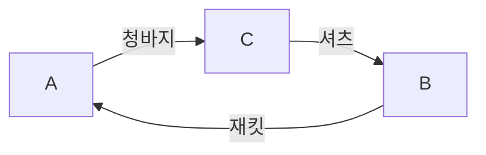

# 빈티지 × Meta AI — 1인 7일 해커톤 아이디어 추천

작성: 2026-10-27  
참여: Claude Opus 5.5 Medium · DeepSeek V4.1 Flash Max · Gemini 4 Argon High · Codex

## 1. 최종 추천: Vintage Relay

> **서로 1:1로는 교환할 수 없는 빈티지 옷을, AI가 취향에 맞는 후보로 좁혀주고 3인 순환교환으로 연결하는 현장 모임용 웹앱.**

네 평가자 모두 **첫날 핵심 검증부터 진행할 만한 1인 7일 출품 후보**로 추천했다. 최종 개인 1순위도 모두 Vintage Relay다. 앱이 검증됐거나 사용자가 개발안을 선택했다는 뜻은 아니다.

기존 폐데님 제조안의 재단·봉제·사진 실측 문제에서 벗어나, **입지 않는 옷을 다른 소유자에게 연결하는 작업**에 집중한다. 사진 설명이나 코디 추천으로 끝나지 않고, 실제 참가자가 동의한 교환표를 만드는 것이 목표다.

기존 비추천 보고서는 [이전 평가 보고서](result6-previous-evaluation.md)에 보존했다. 이 문서는 사용자가 새로 요청한 **아이디어 탐색 결과**이며, 앱 코드는 아직 작성하지 않았다.

## 2. 무슨 앱인지 가장 쉬운 예

이미 모인 빈티지 교환 모임에 다음 세 사람이 있다고 하자.

| 참가자 | 내놓을 옷 | 받고 싶은 옷 |
|---|---|---|
| A | 워싱 청바지 | B의 짧은 재킷 |
| B | 짧은 재킷 | C의 스트라이프 셔츠 |
| C | 스트라이프 셔츠 | A의 워싱 청바지 |

서로 맞교환할 상대는 없다. 하지만 다음처럼 바꾸면 모두 원하는 옷을 한 점씩 받는다.

AI는 이런 선호를 사진과 자연어에서 찾도록 돕는다.

> “진한 얼룩은 싫지만 자연스러운 페이딩은 좋아요. 큰 로고 없는 작업복 느낌의 재킷을 찾고 있어요.”

모델이 정품·가격·정확한 핏을 판단하는 것은 아니다. **취향에 맞을 후보와 확인할 점을 제안하고, 받을지와 교환할지는 사람이 결정한다.**

이 사례의 선호는 설명용 가상 조건이다. 실제로 3인 교환이 얼마나 자주 성사되는지는 조사하지 않았다.

## 3. 사용자와 해결하려는 문제

대상은 전국 단위 중고 플랫폼이 아니라 **이미 모인 소규모 빈티지 동아리·교환 모임의 진행자와 참가자**다.

단품 빈티지는 같은 모델이라도 색 빠짐·로고·수선 흔적·상태가 다르다. “재킷 M” 같은 태그만으로는 원하는 옷인지 판단하기 어렵다. 또한 내가 원하는 옷의 주인이 내 옷을 원하지 않으면 1:1 교환이 막힌다.

이 앱이 해결할 문제는 다음 두 가지다.

1. 비정형 취향과 옷 사진을 연결해 **살펴볼 후보를 찾는 부담**을 줄인다.
2. 참가자가 승인한 선호를 바탕으로 **2·3인 교환을 계산하고, 동의·철회·단품 중복을 관리**한다.

이는 아직 사용자 문제에 대한 가설이다. 작은 모임에서는 옷을 직접 보고 체크하는 방식으로 충분할 수도 있다. 사용하지 않을 옷의 재사용을 도울 가능성은 있지만, 폐기·탄소 감소를 이미 달성했다고 주장하지 않는다.

## 4. 실제 사용 흐름과 7일 MVP

**행사방 1개 · 참가자 3~6명 · 전체 의류 6~12점 이하**로 제한한다. 수량은 구현 범위를 제한하는 계획값이며 성능 측정값이 아니다.

| 단계 | 사용자가 하는 일 | 앱이 하는 일 |
|---|---|---|
| 등록 | 옷 사진·설명과 원하는 스타일·거부 조건 입력 | 사진/설명과 취향 조건 구조화 |
| 후보 확인 | AI 후보를 보고 받고 싶은 옷을 직접 선택 | 이유·불확실성·확인할 점 표시 |
| 순환 제안 | 줄 옷과 받을 옷의 조합 확인 | 승인된 선호에서 2·3인 순환 계산 |
| 거래 동의 | 각자가 전체 교환안에 동의 또는 거절 | 동일 버전 전원 동의와 단품 충돌 검사 |
| 변경 | 품목·조건 수정 또는 철회 | 영향받는 기존 동의 무효화, 재탐색 |
| 마무리 | 현장에서 실물 확인 | 동의한 교환의 인수인계표 생성 |

**“받아볼 의향”과 “이 교환안에 대한 최종 동의”를 구분한다.** 인수인계표 확정도 실제 물건 전달 완료와 구분한다. 거절 뒤 대안이 없으면 미발견을 그대로 보여준다.

사진에 자·마커를 놓거나 옷을 해체할 필요는 없다. 사진으로 확인되지 않은 핏·숨은 하자·진위는 확인한 사실처럼 표시하지 않는다.

### 구현 범위

- 모바일 웹 + Python FastAPI + SQLite.
- 행사 역할 접속, 사진/조건 입력, AI 후보 확인, 순환 제안, 동의·철회, 인수인계표.
- 작은 규모에서는 2·3인 순환을 전수검사한다. 새로운 최적화 알고리즘을 발명했다고 주장하지 않는다.
- 물건·참가자의 중복 확정, 오래된 제안에 대한 동의, 동시 확정 충돌은 코드와 DB 트랜잭션/버전 검사로 막는다.
- 결제·배송·외부 플랫폼 연동·전국 사용자 모집·실시간 채팅·시세·정품 감정·가상 피팅·네이티브 앱은 제외한다.
- 추가 모델·생성 룩북·AR·3D·별도 학습도 넣지 않는다.

## 5. Meta AI가 실제로 필요한 부분

**필수 모델은 `muse-spark-1.3` 하나다.** 모델 개수보다 실제 업무에 기여하는지가 중요하다.

Spark는 이미지 이해·구조화 출력·도구 호출을 지원한다. 이는 취향 해석 성능을 입증한 것이 아니라 구현에 필요한 기능이 제공된다는 뜻이다. [Meta 모델 문서](https://dev.meta.ai/docs/models)

| Spark 담당 | 일반 코드·사람 담당 |
|---|---|
| 사진과 설명을 자연어 취향에 연결 | 실제로 받고 싶은 옷 선택 |
| 거부 조건·애매한 표현 구조화 | 명시적 조건과 확정 선호 저장 |
| 후보 이유와 미확인 사항 설명 | 2·3인 순환과 단품 자원 검사 |
| 현재 상태를 조회하고 변경 후 후보 재검토 | 동의 권한·버전·확정·철회 처리 |

도구 예시는 행사 상태 조회, 승인된 선호의 순환 계산, 아직 확정되지 않은 제안 생성이다. 모델은 도구 결과에 맞춰 다음 제안을 만들며 **사람의 동의를 대신 생성하지 않는다.** 개발자 도구의 실제 실행은 앱 코드가 맡는다. [Meta 도구 호출 안내](https://dev.meta.ai/docs/tool-calling)

수동으로 선호를 고르는 경로도 둔다. 같은 올바른 교환안이 나오는 것은 정상이다. AI 기여는 다음으로 평가한다.

- 취향·거부 조건의 누락/오해를 줄이는가.
- 맞는 후보를 찾기까지 검토·수정 부담을 줄이는가.
- 후보 이유를 이해하고 선택하기 쉬워지는가.

**순환 계산의 성과를 AI의 성과로 계산하지 않는다.** 모델의 후보가 틀리거나 사용자 부담이 늘면 Meta 핵심 기여 주장을 낮춰야 한다.

## 6. 창의성·기술성·시간·대회 적합성 평가

| 관점 | 추천하는 이유 | 남는 가장 강한 반론 |
|---|---|---|
| 창의성 | 빈티지 취향을 단품 순환교환과 전원 동의에 연결 | 교환·순환 알고리즘 자체는 새롭지 않음 |
| Impact | 옷을 자르거나 새로 생산하지 않고 다음 소유자 탐색 | 실제 모임의 수요·교환 성사율 미검증 |
| Meta 활용 | 비정형 사진/언어 조건을 실제 후보 선택에 연결 | 작은 모임은 수동 체크로 충분할 수 있음 |
| 기술·실행 | 범위를 작은 그래프와 명확한 상태 전환으로 제한 가능 | 동시성·철회·권한 오류를 제대로 처리해야 함 |
| 1인 7일 | 외부 DB·봉제·특수 장비·배송/결제 구축이 필요 없음 | API 접근과 종단간 구현이 아직 검증되지 않음 |
| Demo | 1:1 불성립→3인 순환→철회 대응이 직관적 | 가상 역할 시연을 실제 수요 증거로 쓸 수 없음 |

### 선행 서비스와 차별성

옷 교환과 맞좋아요 기반 매칭은 [Lucky Sweater](https://luckysweater.com/how-it-works)에 이미 있다. 다른 도메인에서는 [LinkMySwap](https://linkmyswap.co.uk/chain-swaps)이 3인 이상 순환교환을 안내한다. **“세계 최초 교환 AI”, “최초의 3인 순환”이라고 주장하지 않는다.**

차별성 가설은 **현장 빈티지 모임의 비정형 취향 → 사진 후보 확인 → 단품 순환 → 전원 동의·철회**를 작고 완결된 작업으로 묶는 데 있다. 이 조합의 유용성도 실험해야 한다.

### 해커톤 규칙과의 관계

트랙은 **Indie Developer**, 테마는 **Build for Your World**를 권고한다. 사용자 제공 기준대로 Impact·Meta 활용·기술실행·Demo를 각각 25%로 검토했다.

사진 설명이나 검색 답변보다 **다자 교환 작업을 끝내는 행동과 상태 관리**가 중심이라는 점이 적격성 방어 논리다. 그러나 상태머신이나 도구 호출이 있다고 자동 적격이 되는 것은 아니다. 단순 이미지 분석기 해당 여부의 최종 판단은 주최자에게 있다.

공개 저장소, 기간 중 신규 기여 구분, 3분 영상, 데이터 사용 권리를 지킨다. 본인이 직접 촬영했거나 허가받은 자료를 쓰고, 타인의 사진·음성·영상 권리가 자동 해결된다고 가정하지 않는다.

## 7. 첫날 검증과 남은 7일 계획

**추천은 첫날 검증부터 시작하자는 수준이다. 아직 아래 실험을 수행하지 않았다.**

| 일자 | 목표와 확인할 것 |
|---|---|
| D1 | 사진/조건 준비 시간을 포함해 기록. 실제 Spark 이미지·구조화·도구 왕복 확인. 수동 폼 대비 조건 누락·후보 검토·수정 부담 비교. 3인 순환·미발견·철회 사례 기술 스모크 |
| D2 | 행사·역할·옷 등록과 AI 후보 확인을 연결 |
| D3 | 승인 선호 기반 2·3인 순환을 화면까지 종단간 완성 |
| D4 | 동의·철회·단품 충돌·오래된 버전 거부·인수인계표 |
| D5 | 동의받은 시험자의 실제 취향으로 이해·수용·검토 부담 확인. 기회가 없으면 미수행 공개 |
| D6~7 | 안정화, 실패 사례, 3분 영상, README·공개 저장소·신규 기여 정리 |

비교 지표와 통과 기준은 **시험 전에** 정하고, 실패 후 성공에 맞춰 바꾸지 않는다. 가상 참가자 조건과 실제 선호 평가는 구분한다. 개발자가 만든 조건으로 순환을 찾았다는 사실은 알고리즘 검증이며 실제 수요·모델 성능의 증거가 아니다.

다음 경우에는 출품안 추천을 재검토한다.

- API를 사용할 수 없거나, 수정 후에도 중요한 취향·거부 조건을 반복해서 놓친다.
- 단품 중복 확정·동의 버전 오류가 해결되지 않는다.
- D3까지 종단간 흐름이 동작하지 않는다.
- D5까지 AI가 조건 해석이나 후보 검토 부담에 실질적으로 기여한다는 근거를 얻지 못한다.

실패하면 다른 두 앱을 같은 주에 자동으로 연달아 만들지 않는다. 아이디어 선택으로 돌아간다.

## 8. 3분 데모

1. **0:00~0:25** — 직접 촬영한 옷과 가상 참가자 역할임을 표시. 1:1로는 맞교환이 안 되는 상황 설명.
2. **0:25~1:00** — 자연어 취향을 입력하고 Spark의 후보·이유·확인점을 확인. 참가자가 받을 의향 선택.
3. **1:00~1:35** — 3인 순환과 각자 줄 옷·받을 옷을 표시.
4. **1:35~2:15** — 한 사람이 철회하면 기존 동의가 무효화됨을 시연. 대안이 없으면 미발견도 정직하게 표시.
5. **2:15~3:00** — 유효한 제안의 전원 동의와 인수인계표. 모델 역할·코드 검사·미검증 사항을 짧게 설명.

일부러 알고리즘을 실패시키거나, 가상 역할 시연을 실제 교환·폐기 감소 성과로 발표하지 않는다.

## 9. 함께 검토한 대안과 제외 이유

총 **독립 제안 9개 + Codex 제안 2개**를 검토했다. 유사한 안은 묶어 비교했다.

| 후보 | 내용 | 최종 위치 |
|---|---|---|
| **Vintage Relay** | 취향 후보·2/3인 순환·전원 동의·철회 | 주 추천 |
| **축소 DropCut** | 검수 영상의 발화를 부위·원본 구간에 연결한 HTML 상태카드 | 대안. 기존 [Patina Inspector](idea.md)의 경량 개선안 |
| **Condition Handover / PatinaDiff** | 기존 흔적과 수령 후 변화 후보 대조 | 보류. 비강체 정렬·조명 오탐이 7일 연구 위험 |
| 옷의 구술사 | 음성 기억과 의류 부위 연결 | 감성적 매력은 있으나 유사 서비스와 차별·효용 미검증 |
| Capsule Curator / Vintage Window | 옷을 테마로 묶어 포스터·드롭 키트 생성 | 분석·마케팅 콘텐츠 생성에 머물 위험 |
| Repair Triage | 추가 관찰 후 수선 브리프 생성 | 공방 검증 없이 사진 분석·권고문에 머물 위험 |
| 연대 단서 모순 탐지 | 라벨·부자재의 시기 단서 대조 | 참조 자료·표본·정확성 부담, 식별/감정 분석기 인접 |
| RackIndex | 행거 영상에서 옷별 재고 추출 | 가림 후 추적 ID 전환, 단순 태거로 축소될 위험 |
| ClaimDesk | 판매 채팅의 모호한 품목 요청을 예약 대기열로 정리 | 외부 연동 없는 모의 콘솔의 실용성과 차별 미검증 |

DropCut의 핵심은 영상→전사→부위 후보→사람 수정→원본 링크 카드다. [Artifcts](https://artifcts.com/articles/post/use-your-voice-artifcts-now-offers-in-app-audio--video-recording)의 사물 음성 기록과 [ThingLink](https://support.thinglink.com/hc/en-us/articles/360021500733-How-to-create-an-interactive-image)의 핫스팟 기능 같은 선행이 있다. 기존 Inspector와 같은 계열이므로 완전히 새로운 아이디어로 포장하지 않는다.

이를 선택한다면 **사용자가 확정한 진술 ID와 카드 연결 ID의 누락만** 코드로 검사한다. STT가 놓친 말·언급되지 않은 하자·거짓 진술을 보장할 수 없다. Muse Voice는 **발화 턴 단위 시간**을 제공하며 단어 단위 시간이나 감정 추론을 제공하지 않는다. [Meta 음성 전사 문서](https://dev.meta.ai/docs/speech-to-text)

SAM이 주름을 무시하거나, 가려진 옷의 동일 ID를 끝까지 보장한다는 초회 제안의 표현은 철회했다. PatinaDiff의 높은 초회 점수도 최종 추천 근거로 채택하지 않았다.

## 10. 실제 토론 결과와 근거 문서

세 자문자는 처음에 구술사·캡슐 큐레이션·전후 Diff를 각각 선호했다. 교차토론에서는 축소 DropCut으로 모였지만, 기존 기획과의 중복, 모델 수와 깊이를 혼동한 평가, 비전·전사 성능 과장을 다시 검토했다.

최종 동일 문서에 새로 투표한 결과는 다음과 같다.

| 평가자 | 공동 추천 | 최종 개인 1순위 | 필수 추가 수정 |
|---|---|---|---|
| Claude Opus 5.5 Medium | APPROVE | Vintage Relay | 없음 |
| DeepSeek V4.1 Flash Max | APPROVE | Vintage Relay | 없음 |
| Gemini 4 Argon High | APPROVE | Vintage Relay | 없음 |
| Codex | APPROVE | Vintage Relay | 없음 |

**만장일치는 이 후보를 첫날 검증부터 추천한다는 뜻이다.** 실제 수요·정확도·환경 효과·적격성·수상 가능성이 확인됐다는 뜻은 아니다. 점수 평균으로 합의를 만들지 않았다. Claude가 강조한 시험 전 지표/기준 공개와 AI 기여 철회 조건도 반영했다.

최종 runtime에서 Claude `claude-opus-5-5`/effective `medium`, DeepSeek `deepseek/deepseek-flash`/effective `max`, Gemini `gemini-4-argon-high`를 확인했다.

- [동일 최종 추천 문서](docs/reviews/result6-new-final-proposal.md)
- Claude: [독립 제안](docs/reviews/result6-new-claude-ideas.md) · [교차토론](docs/reviews/result6-new-claude-debate.md) · [재반론](docs/reviews/result6-new-claude-rebuttal.md) · [최종 투표](docs/reviews/result6-new-claude-final-vote.md)
- DeepSeek: [독립 제안](docs/reviews/result6-new-deepseek-ideas.md) · [교차토론](docs/reviews/result6-new-deepseek-debate.md) · [재반론](docs/reviews/result6-new-deepseek-rebuttal.md) · [최종 투표](docs/reviews/result6-new-deepseek-final-vote.md)
- Gemini: [독립 제안](docs/reviews/result6-new-gemini-ideas.md) · [교차토론](docs/reviews/result6-new-gemini-debate.md) · [재반론](docs/reviews/result6-new-gemini-rebuttal.md) · [최종 투표](docs/reviews/result6-new-gemini-final-vote.md)
- Codex: [독립 제안·선행 확인](docs/reviews/result6-new-root-ideas.md) · [교정 요구](docs/reviews/result6-new-root-rebuttal.md) · [최종 투표](docs/reviews/result6-new-root-final-vote.md)

원문에는 이후 철회한 수치·주장이 포함된다. 최종 범위는 이 보고서와 동일 최종 추천 문서를 기준으로 한다. **실제 모델 API·의류·사용자·교환 실험은 아직 수행하지 않았다.**

